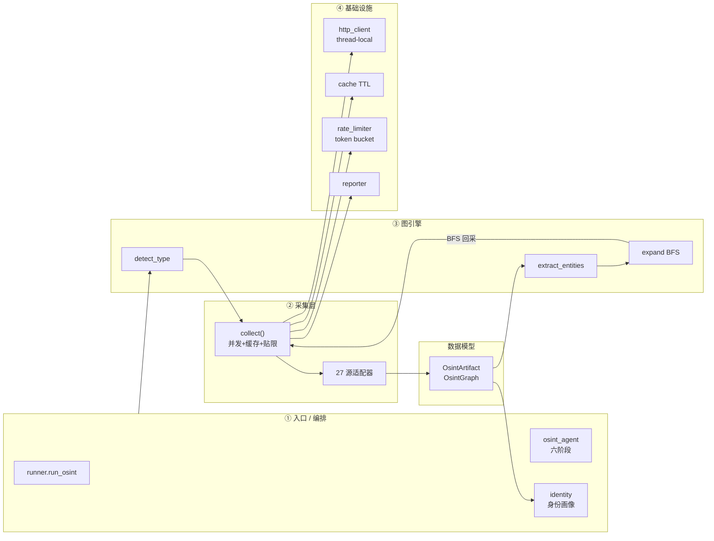
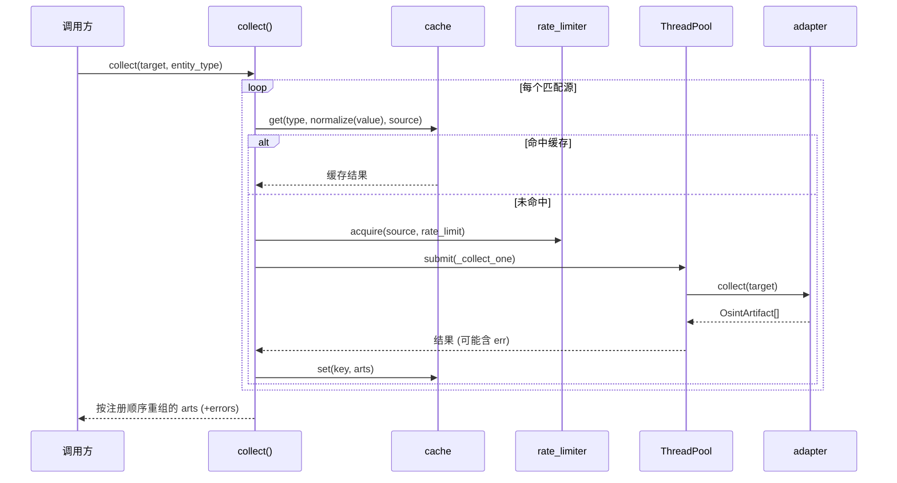
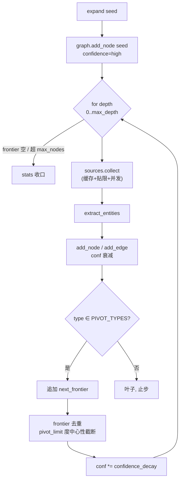
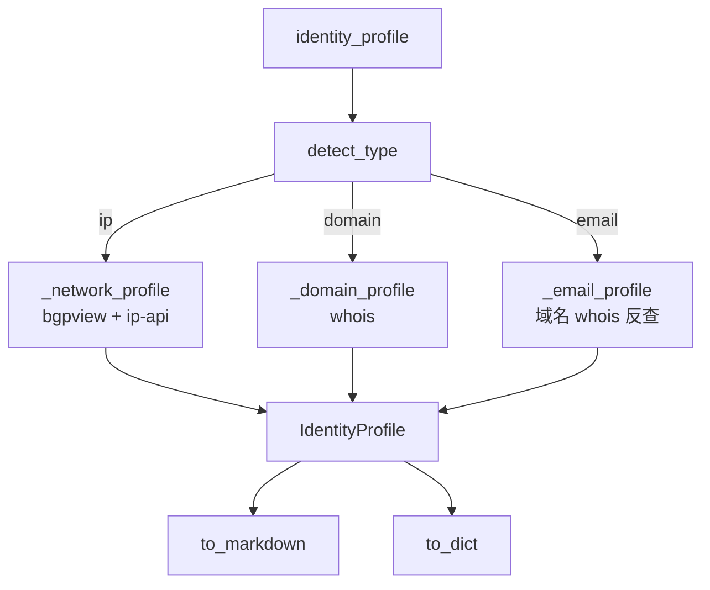

# froghacker-osint 架构说明书

> 蛙客「开源情报（OSINT）分析」开源版 · 27 源 · 四层架构（入口/编排 → 采集 → 图引擎 → 基础设施）
> 更新：2026-10-29（从主仓库 `tools/osint/` 剥离，剥离项见 [MANIFEST.md](../MANIFEST.md)）

## 目录

1. [总览](#1-总览)
2. [采集层 `sources/`](#2-采集层-sources)
3. [图引擎 `graph_engine.py`](#3-图引擎-graph_enginepy)
4. [身份画像 `identity.py`](#4-身份画像-identitypy)
5. [基础设施](#5-基础设施)
6. [数据模型 `artifacts.py`](#6-数据模型-artifactspy)

---

## 1. 总览



**数据流（一次 collect）**

```
detect_type(target) → entity_type
      │
      ▼
sources.collect(target, entity_type)
      │  ① 过滤 enabled（付费缺 key 跳过）
      │  ② cache.get(key) 命中 → 跳过网络
      │  ③ rate_limiter.acquire 贴限
      │  ④ ThreadPoolExecutor 并发
      │  ⑤ thread-local requests.Session 发请求
      │  ⑥ as_completed 乱序 → 按注册顺序重组（确定性）
      ▼
OsintArtifact[] ──► extract_entities ──► {nodes, edges}
      │                                      │
      ▼                                      ▼
reporter 输出 / identity_profile     OsintGraph.expand() BFS 多跳
```

> 开源版入口为 Python API（`collect` / `expand_graph` / `identity_profile` / `run_agent` / `list_sources`），
> 主仓库的 `cli.py`（CLIRegistry 平台耦合）已剥离。

---

## 2. 采集层 `sources/`

### collect() 时序



### 27 源适配器

**免费源（15，无 key）**

| 源 | 实体类型 | 限流 `rate_limit` | 说明 |
|----|----------|------------------|------|
| crtsh | domain, subdomain | — | 内部 `sleep(3)` |
| wayback | domain, subdomain | `(1,1)` 1/s | 礼貌限速 |
| dns | domain, subdomain | — | dnspython 本地递归 |
| whois | domain | — | 内部 `sleep(2)` socket |
| emailrep | email | `(1,1)` | 待标定 |
| hackertarget | domain, subdomain, ip | `(50,86400)` 50/day | 官方 200/day 取保守 |
| urlscan | domain, ip, url | `(20,60)` 20/min | +500/day |
| otx | domain, ip | `(1,1)` | 待标定 |
| github_api | username, org | `(60,3600)` 60/h | 官方 |
| blockchain | crypto_address | `(1,1)` | 待标定 |
| chainabuse | crypto_address | `(1,1)` | 待标定 |
| reddit | username | `(1,1)` | 公开 JSON 限流 |
| phone | phone | — | 仅国际区号→国家映射（简化） |
| **bgpview** | asn, ip | `(2,1)` 2/s | CF 限流，社区 ~3 RPS |
| **macvendor** | mac | `(1,1)` 1/s | 官方 1/s+1000/day |

**付费源（12，缺 key 时 `enabled()=False` 跳过）**

| 源 | 实体类型 | env_key(s) |
|----|----------|-----------|
| abuseipdb | ip | ABUSEIPDB_API_KEY |
| censys | ip | CENSYS_API_ID + CENSYS_API_SECRET |
| dehashed | email, username, domain, ip, phone | DEHASHED_API_KEY + DEHASHED_EMAIL |
| etherscan | crypto_address | ETHERSCAN_API_KEY |
| greynoise | ip | GREYNOISE_API_KEY |
| hibp | email | HIBP_API_KEY |
| hunter | domain | HUNTERIO_API_KEY |
| intelx | email, domain, ip, phone, username | INTELX_API_KEY |
| leakix | email, domain, ip, username | LEAKIX_API_KEY |
| securitytrails | domain | SECURITYTRAILS_API_KEY |
| shodan | domain, ip | SHODAN_API_KEY |
| vt | domain, ip | VT_API_KEY |

> 粗体 = 新增（相对上一版本）。`entity_type` 决定 `adapters_for(type)` 匹配哪些源并发采集。
> `phone` 源已简化：仅保留国际区号→国家映射，主仓库的 `telecom_fraud` 号段库（攻击侧）已剥离。

---

## 3. 图引擎 `graph_engine.py`

### 边类型全表（16 种边实例）

| 源实体 | 目标实体 | 关系 `rel` | 触发字段 `raw` | 数据来源 |
|--------|---------|-----------|---------------|---------|
| domain | ip | `resolves_to` | `ip` | dns, hackertarget |
| subdomain | domain | `has_subdomain` | `parent` | crtsh |
| subdomain | ip | `resolves_to` | `ip` | crtsh |
| cert | subdomain | `cert_san` | `subdomains`/`common_name` | crtsh |
| domain | person/org/email | `registered_to` | whois | whois |
| email | domain | `email_of` | 域名 | emailrep |
| ip | subdomain/domain | `hosts_on` | `hostname`/`domain` | hackertarget/greynoise |
| ip | domain | `hosts_on` | `reverse_ip` | hackertarget |
| domain | domain | `dns_record` | MX/NS | dns |
| domain | domain | `cname` | CNAME | dns |
| username | social_profile | `has_profile` | `username` | reddit/github |
| phone | org | `registered_to` | `carrier` | phone |
| crypto_address | breach | `registered_to` | `tag`/`category` | chainabuse |
| **ip** | **asn** | **`belongs_to`** | `asn` | **bgpview** |
| **asn** | **org** | **`registered_to`** | `org`/`name` | **bgpview** |
| **mac** | **org** | **`registered_to`** | `org`/`vendor` | **macvendor** |

> 粗体 = 新增。

### expand() BFS 多跳



**可枢轴 vs 叶子**

| 类别 | 实体 |
|------|------|
| PIVOT_TYPES（可扩展） | domain, subdomain, ip, email, username, org, person, phone, crypto_address, **asn**, **mac** |
| 叶子（止步） | url, cert, breach, dns_record, social_profile |

---

## 4. 身份画像 `identity.py`



> 电信画像 `telecom`（phone 号段库，依赖主仓库 `telecom_fraud`，攻击侧）已剥离；
> `IdentityProfile.telecom` 字段保留为空占位，`identity_profile()` 不产出电信画像。

### ip 画像数据合并优先级

```
_network_profile(ip)
│
├─ ① bgpview (优先, BGP 权威)     bgp.cached_collect()  (缓存+贴限统一)
│     asn     = a.value           "as15169"   ← normalize 小写
│     org     = raw.org           "GOOGLE"
│     country = raw.country       "US"
│
├─ ② ip-api (补缺 + 纯 geo)       cache.get + limiter.acquire(45/min)
│     city    = geo.city          "Mountain View"   ← ip-api 独占
│     isp     = geo.isp           "Google LLC"
│     asn/org/country 仅 bgpview 空时 → geo.as / org / country 回填
│
└─ 合并规则: bgpview 精确值优先, ip-api 补 city/isp 及缺失字段
```

### 画像字段

| 画像 | 数据源 | 输出字段 |
|------|--------|---------|
| 网络 `network` | bgpview（BGP）+ ip-api（geo） | ip, asn, org, country, city, isp |
| 域名 `domain` | `domain_intel._query_whois`（socket） | domain, registrar, registrant_name/org/email, creation_date |
| 邮箱 `email` | 域名 whois 反查 | email, domain, registrar, registrant_name/org |

---

## 5. 基础设施

| 模块 | 职责 | 关键设计 |
|------|------|---------|
| `http_client.py` | HTTP 层 | **thread-local** `requests.Session`（并发下不共享单例）；`safe_get_json/text/post` 缺 key/异常返回 None 不抛 |
| `stealth_session.py` | 礼貌采集（可选） | `StealthSession`（drop-in requests.Session）：UA 轮换 + per-domain 延迟 + 429/503 退避 + `Retry-After` + WAF/CAPTCHA 检测不绕过 |
| `cache.py` | TTL 缓存 | `TTLCache` 内存不落盘（敏感数据）；key=`(synonym_key, source)`；默认 300s / `OSINT_CACHE_TTL`；下沉到 `SourceAdapter.cached_collect`（collect 与 identity 直调共享） |
| `rate_limiter.py` | 贴限 | `TokenBucket` + 模块级单例 `RateLimiter`，跨 collect/identity 共享额度；`rate_limit=(requests, seconds)` 声明式 |
| `reporter.py` | 进度/格式化 | `Progress` 单行刷新到 **stderr**（保 JSON stdout 干净）；`format_artifacts` 统一格式 |

> 默认 HTTP 层用标准 `requests.Session`。可选礼貌采集层见 `stealth_session.py`（UA 轮换/退避/检测不绕过），
> 对抗部分（ProxyPool 代理池、BrowserStealth 指纹伪装）未开源，见 [MANIFEST.md](../MANIFEST.md)。

---

## 6. 数据模型 `artifacts.py`

### 实体类型

```
ENTITY_TYPES = person, username, email, org, domain, subdomain, ip, asn, mac,
               url, cert, breach, dns_record, social_profile, phone, crypto_address
```

### normalize 规则

| 实体 | 归一化 |
|------|--------|
| domain/subdomain | 小写 + 去尾点 |
| email | 小写 + 去空格 |
| ip | 小写 + 去端口 |
| url | 小写 + 去尾斜杠 |
| username | 小写 |
| asn | 小写 |
| mac | 去冒号/横线 + 小写 |
| phone | 去分隔符 `[\s\-().]` |
| crypto_address | 去空白（保留大小写） |
| person/org | 仅去首尾空格（保留大小写） |

### 同义撞击 `synonym_key`

`normalize` 只做**形式同义**（大小写/分隔符），`synonym_key` 再做**跨类型同义撞击**，让指向同一底层实体的表达撞到同一规范键：

| 实体 | 撞击到 |
|------|--------|
| email | `domain:{@ 后域名}`（`admin@x.com` → `domain:x.com`） |
| url | `domain:{hostname}`（`https://x.com/a` → `domain:x.com`） |
| 其余 | `{entity_type}:{normalize(value)}` |

用于 cache key 去重：`admin@example.com` 和 `example.com` 撞同一键，避免对同一域名重复网络采集。
（subdomain→注册域需 PSL、org 名去后缀有歧义，暂未做。）

### 核心类

```python
@dataclass
class OsintArtifact:
    source, entity_type, value, label, raw, evidence, confidence, fetched_at
    # value 经 normalize 归一化, node_id = f"{entity_type}:{value}" 确定性去重

@dataclass
class OsintGraph:
    nodes: dict   # id -> {id, name, type, label, path, confidence}
    edges: dict   # (source, target, rel) -> {source, target, rel, confidence}
    stats: dict   # {nodes, edges, depth, sources}
```
